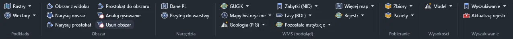
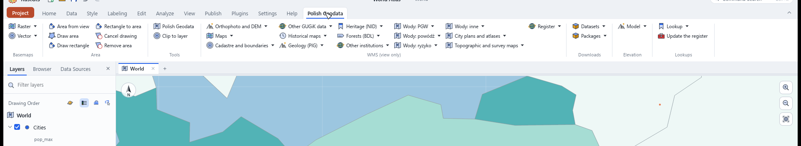
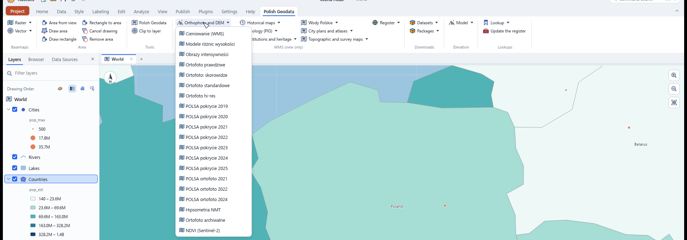
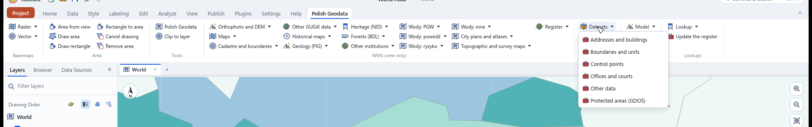
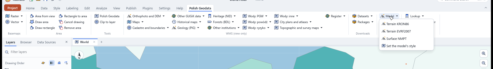
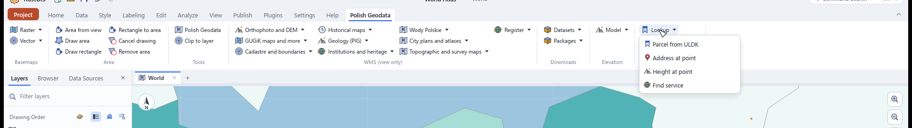
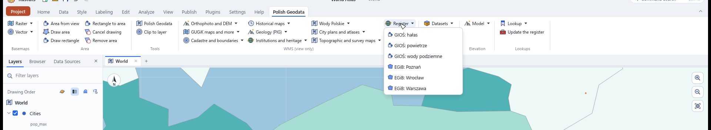
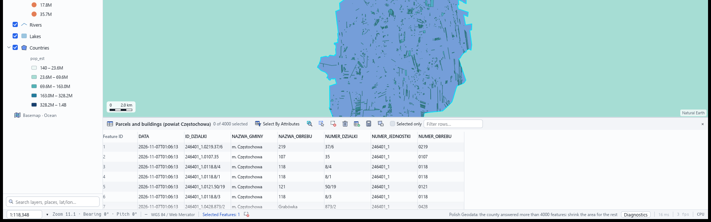

# Polish Geodata for RustGIS

One tab for Polish public geodata: 112 raster overlays, and the national vector data downloaded as
editable layers.

| What it gives you | Detail |
| --- | --- |
| Raster overlays | 112 WMS: orthophoto, BDOT10k, parcels, addresses, boundaries, place names, historical maps, geology, protected areas, Wody Polskie, Cartomatic |
| Vector download | 106 WFS datasets and 162 sheet indexes, as layers with progress and Cancel |
| Protected areas | 15 GDOŚ types: national parks, reserves, Natura 2000, landscape parks |
| County parcels | `dzialki-powiat`: the county's own EGiB, paged to 20 000 features |
| Any register service | `rejestr-pobierz`: a WFS from the register by id, one bounded request per type |
| Service register | 3 296 proved addresses, 1 742 WMS from 570 institutions and 1 554 WFS, with an update tool |
| Area | from the view, a box, a GeoJSON shape, or a gmina, powiat, voivodeship, obręb or city |
| Clip | any layer to a boundary, in the panel or in the same run with `przytnij` |
| Elevation | three 1 m models, three looks, 3D terrain with a vertical scale |
| Lookups | parcel by identifier or point, address and reverse address, height, obręb lists, CSV runs |
| Agent ready | 236 commands, 13 tools, every command declaring its arguments, a skill for the assistant |



Seven groups hold the tab: basemaps, area, tools, WMS overlays, downloads, elevation and lookups.
Data names stay as they are published, so the tab reads the same in either language.



The same tab in English, zoomed to Poland: ten WMS menus, the downloads, the elevation models and the
lookups sit in two rows.



One menu holds nineteen overlays: hillshade, difference models, the orthophoto series, POLSA land
cover for seven years, hipsometry and NDVI. One click adds a layer, a second click removes it.



Every download entry opens a background run with progress and a Cancel button.



The elevation models come from the area you point at: three 1 m models, a look switch and a 3D
terrain with a vertical scale.



Parcel, address, height and the register's service search sit in the lookups.



The register menu carries six proved services: GIOŚ noise, air and groundwater, and the EGiB of
Poznań, Wrocław and Warsaw.



The county EGiB arrives as a vector layer: 4 000 parcels of Częstochowa with their identifiers,
names and obręb codes, ready to select, clip and export.

## Install

- **From a package:** install `polish-geodata-0.1.3.rgplugin` through **Plugins › Plugin Manager ›
  Install from file**.
- **From a folder:** point at `dist\polish-geodata` through **Plugins › Plugin Manager › Settings ›
  Add Plugin Folder…**.
- **Without installing:**

```powershell
rustgis-cli run --plugin .\dist\polish-geodata --sample --cmd 'plugin:polish-geodata/obszar-widok={}'
```

The plugin is one static `.exe` that RustGIS starts on each call. It needs no Python and no GDAL.
RustGIS 0.5.0 or newer.

## The tab

| Group | What it holds |
| --- | --- |
| **Basemaps** | 4 raster maps and 4 vector overlays: orthophoto, BDOT10k, parcels, addresses, boundaries |
| **Area** | area from the view, draw, rectangle, adopt, cancel, remove |
| **Tools** | the panel and the clip to a boundary |
| **WMS overlays** | ten menus: GUGiK (76 through three menus), historical maps (11), PIG geology (11), institutions and heritage (17), Wody Polskie (32), Cartomatic (45 through two menus), Register (6) |
| **Downloads** | six WFS tools, four package tools, protected areas (GDOŚ), the county EGiB, any register WFS |
| **Elevation** | three elevation models, a look switch, 3D terrain and its switch off |
| **Lookups** | parcel, address, height, find a service, update the register, obręby, the view's register |

One rule holds the tab together: **a command shows something at once, a tool downloads in the
background**, with progress and a Cancel button. The exception is the three elevation commands,
because a tool cannot add a raster layer.

Every download lands as a layer you can select, clip, style and export. A WFS filter returns whole
features that touch the area, so the clip is what cuts them to the boundary.

## Area

Every download needs an area layer. Five buttons make one, and three commands set it from a script:

| Button | What it does |
| --- | --- |
| **Area from the view** | saves the current view as the area, exactly what you see |
| **Draw area** | draws a polygon, and the download follows the shape |
| **Draw rectangle** | arms the app's rectangle tool, which draws a graphic |
| **Rectangle to area** | moves that graphic into the area layer |
| **Remove area** | starts from an empty layer |

| Command | What it takes |
| --- | --- |
| `obszar-json` | `{"bbox": [west, south, east, north]}` or `{"geojson": <Feature>}` |
| `obszar-jednostka` | `{"nazwa": "Poznań", "poziom": "gmina"}` and optional `przytnij` |
| `obreby` | `{"teryt": "306401_1"}`, the obręby a unit publishes |
| `obszar-dodaj` | keeps the current area as its own layer, Area 1, Area 2, or takes `{"nazwa": "Gmina A", "bbox": […]}` |

`poziom` accepts `gmina`, `powiat`, `wojewodztwo`, `obreb` or `miasto`. A city that PRG lists only
as a gmina falls back to its gmina boundary. `przytnij` cuts a named layer to that unit in the same
run, so one call gives a layer already clipped to the boundary.

The plugin never guesses an area from the active layer. A drawn polygon becomes a rectangle for the
elevation model, and the message says which.

## Downloads

Six tools take WFS data by dataset: 106 map datasets and 162 sheet indexes. GDOŚ adds 15 protected
area types. Four package tools put a sheet index on the map and fetch the files its features point
at.

| Limit | Value |
| --- | --- |
| Features per download | 6 000 |
| Span for parcels and buildings | 0.15° |
| Span for boundaries and units | 20° |
| Size gate before the run | 25 MB, the panel slider sets 5 to 500 MB |
| Hard ceiling | 256 MB |

A city's parcels weigh about 9 MB, measured on Warsaw: 5 248 parcels. The gate asks once, and the
**Download even if large** tick answers for every later run. An area the service counts at zero
stops before the first page.

The WFS filter returns whole features that touch the area. **Clip to layer** cuts them with the
built-in Clip and replaces the layer with the result.

**Batch over several areas.** Make an area with any button, press **Keep the area**, make the next one,
press it again. Each press keeps a copy as Area 1, Area 2, and one download then runs over all of them: `gp.batch {"tool": "plugin:polish-geodata/pobierz-granice", "inputs": ["Gmina A", "Gmina B"],
"params": {"dane": "A03_Granice_gmin"}}` adds one layer per area, in one background run with progress
and Cancel.

`rejestr-pobierz` reads any WFS the register lists: name the register id and optionally the types,
and one bounded, paged request per type comes back as a layer. `dzialki-powiat` is the same idea for
the county EGiB, with ULDK naming the county and the register giving its address.

## Elevation

Three models from GUGiK at 1 m: terrain in PL-EVRF2007-NH, surface in PL-KRON86-NH, and a model of
the whole country. A model becomes the 3D scene's ground with `map.terrain`, and the vertical scale
is set by `exaggeration` from 0 to 20. The look is `colours`, `classes` or `shading`. **Terrain 3D
off** takes the model off the ground again.

A big grid waits for a second press. The first press counts cells, MB and seconds and downloads
nothing. The second press, within 120 s, downloads. A small grid goes at once, and a grid already in
the cache needs no press at all.

## Register of services

`data/eziudp.json` carries 3 296 addresses. Each one answered a real request when the register was
built: 1 742 WMS from 570 institutions and 1 554 WFS. Three roads to them:

- **Panel, Mapa tree, Register EZiUDP root:** an institution, then its WMS. A click adds the service
  as an overlay.
- **Ribbon, Register menu:** six services the catalogue does not hold, all proved: GIOŚ (noise, air,
  groundwater) and the EGiB of Poznań, Wrocław and Warsaw.
- **Command `zrodla`:** searches by dataset name, institution and TERYT, WFS included, and
  `{"dodaj": "<id>"}` adds one service.
- **Command `rejestr-widok`:** narrows the register to the county under the map view, so a search
  starts where the map is.

The tool **Update register** reads the EZiUDP register again. It checks only the addresses the file
does not hold, and writes the result outside the package. The command `eziudp` asks the live register
and demands a filter, because the whole register is 9 MB.

Wody Polskie: `wody-warstwy` lists a service's layers with their titles, and the `warstwa` parameter
puts one layer on the map instead of all of them.

## Lookups

| Command or tool | Service | What it answers |
| --- | --- | --- |
| `geokoduj` | UUG | point, street, number and postcode for an address |
| `adres-odwrotnie` | UUG | the address under the map centre or under `lon`, `lat` |
| `wysokosc` | NMT | the height in PL-KRON86-NH at a point |
| `dzialka-id` | ULDK | the parcel boundary for an identifier |
| `parcel` | ULDK | the parcel under the map centre |
| **Geocode a CSV** (tool) | UUG | a point layer from a CSV, with a count of the misses |
| **Check parcels from a CSV** (tool) | ULDK | a parcel layer from a CSV, with a count of the misses |

## For agents

```text
run_command  plugin:polish-geodata/katalog   {}
run_command  plugin:polish-geodata/zrodla    {"instytucja": "GIOŚ", "rodzaj": "wms"}
run_command  plugin:polish-geodata/mapa      {"panel": {"mapa": "v:bdot"}}
run_tool     plugin:polish-geodata/pobierz-granice  {"dane": "A03_Granice_gmin", "obszar": "Obszar pobierania"}
```

Every command declares its arguments in `params`, so `rustgis-cli commands` and the assistant see
them without reading code. `katalog` lists every service, dataset and identifier, so an agent does
not read the manifest.

The package carries `skills/polish-geodata/SKILL.md`. The assistant in RustGIS knows the area
commands, the limits and the download tools while the plugin is on.

## Limits

- A download ends at 6 000 features. A bigger area gets a count and a refusal.
- The clip cuts by the boundary's box, not by its polygons.
- Wody Polskie commands put all of a service's layers on the map unless `warstwa` names one.
- A county may publish several WFS addresses. The county EGiB command tries each before it refuses.
- GUGiK's WFS answers GML only. The plugin converts it locally to GeoJSON, streamed.
- No LAZ files and no geodatabases from dane.gov.pl. The package tools take what the sheet index's
  `url_do_pobrania` points at.
- An empty area stops before the first request, which saves a page.

## Repository

| Path | What it is |
| --- | --- |
| `src/` | the plugin, one module per subject |
| `data/` | the catalogues: services, WFS datasets, Wody, Cartomatic, GDOŚ, PIG, register, ribbon |
| `tools/` | the builders that prove every address written to `data/`, plus the fuzzer |
| `packaging/` | the packager in Rust, which writes `.rgplugin` |
| `plugin.json` | generated from `data/` and `tools/manifest.base.json` |

`plugin.json` carries 236 commands, 13 tools and 209 Polish translations. It is generated, so change
`tools/manifest.base.json`.

```powershell
python tools/manifest.py            # writes plugin.json
python tools/manifest.py --check    # exits 1 when plugin.json is stale
```

## Build

```powershell
cargo test
cargo build --release
cargo run --release -p package -- --allow-missing
python tools/fuzz.py --cases 12 --seed 1 --report D:/Scratch/fuzz.json
```

The packager writes `dist\polish-geodata\` (the folder for the plugin manager),
`dist\polish-geodata-0.1.3.rgplugin` and `dist\polish-geodata.json` (the registry entry). The
archive is deterministic: two runs on the same binaries give the same SHA-256.

`tools/fuzz.py` runs real downloads with a seed and a timeout, so the same run gives the same cases.
It sorts each case into OK, REFUSED, TIMEOUT or CRASH, and prints what the run says about the
download path. `tools/probe.py` checks every catalogue address against a real tile, and
`tools/smoke.py` runs every command over the app's MCP session.

## Languages

English is the base, Polish the translation, and every other language code answers in English.
Interface text lives in `i18n.pl`, runtime messages in `src/text.rs`, both complete. The build stops
when an interface string has no Polish version, or when a Polish line matches no string. Data names
stay as published, so "Działki" and "GIOŚ: hałas" read the same in both languages.

## Sources

Data comes from GUGiK ([geoportal.gov.pl](https://www.geoportal.gov.pl)), GDOŚ, PIG, Wody Polskie
and Cartomatic. Every layer carries its institution as attribution. The plugin reads public services
and sends no data through a server of ours.

Polish version: [README.pl.md](README.pl.md).
