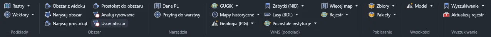
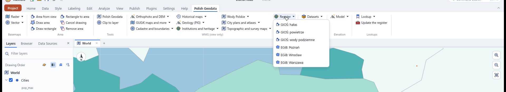
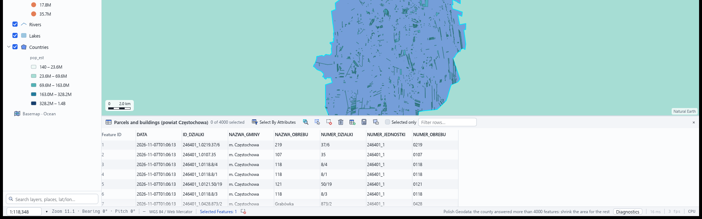

# Polish Geodata: polskie dane geodezyjne w RustGIS

Wersja polska. Wersja angielska, wysyłana w paczce: [README.md](README.md).

Jedna zakładka z polskimi danymi publicznymi: podkładami, działkami, adresami, granicami,
obszarami chronionymi, geologią, modelami wysokości i przeszukiwalnym rejestrem 3 296 adresów
WMS i WFS.

## Instalacja

- **Z paczki:** zainstaluj `polish-geodata-0.1.2.rgplugin` przez **Plugins › Plugin Manager › Install from file**.
- **Z folderu:** wskaż `dist\polish-geodata` przez **Plugins › Plugin Manager › Settings › Add Plugin
  Folder…**.
- **Bez instalacji:**

```powershell
rustgis-cli run --plugin .\dist\polish-geodata --sample --cmd 'plugin:polish-geodata/obszar-widok={}'
```

Wtyczka to jeden statyczny plik `.exe`, który RustGIS uruchamia przy każdym wywołaniu. Nie wymaga
Pythona ani GDAL-a. Wymaga RustGIS 0.5.0 lub nowszego.

## Zakładka

| Grupa | Co zawiera |
| --- | --- |
| **Podkłady** | 4 mapy rastrowe i 4 nakładki wektorowe: ortofoto, BDOT10k, działki, adresy, granice |
| **Obszar** | obszar z widoku, rysowanie, prostokąt, przejęcie, anulowanie, usuwanie |
| **Narzędzia** | panel i przycinanie do granicy |
| **WMS (podgląd)** | GUGiK (76), mapy historyczne (11), geologia PIG (11), NID (4), BDL (4), pozostałe instytucje (w tym IMGW 4 i GUS 2), **Więcej map** (Wody Polskie 30, Cartomatic 45), **Rejestr** (6) |
| **Pobieranie** | sześć narzędzi WFS, cztery narzędzia paczek, ochrona przyrody (GDOŚ) |
| **Wysokości** | trzy modele wysokości, styl, teren 3D i jego wyłączenie |
| **Wyszukiwanie** | działka, adres, wysokość, znajdź usługę, aktualizacja rejestru |







Zakładkę trzyma jedna zasada: **polecenie pokazuje coś od razu, narzędzie pobiera w tle**, z
postępem i przyciskiem Anuluj. Wyjątkiem są trzy polecenia wysokości, bo narzędzie nie umie dodać
warstwy rastrowej.

## Obszar

Narzędzie pobierania wymaga warstwy obszaru. Pięć przycisków tworzy jedną:

| Przycisk | Co robi |
| --- | --- |
| **Obszar z widoku** | zapisuje bieżący widok jako obszar, dokładnie to, co widać |
| **Narysuj obszar** | rysuje poligon, a pobieranie idzie za kształtem |
| **Narysuj prostokąt** | uzbraja narzędzie prostokąta z aplikacji, które rysuje grafikę |
| **Prostokąt do obszaru** | przenosi tę grafikę do warstwy obszaru |
| **Usuń obszar** | zaczyna od pustej warstwy |

Wtyczka nie zgaduje obszaru z aktywnej warstwy. Narysowany poligon staje się prostokątem dla modelu
wysokości, a komunikat podaje, którym. Przycinanie w panelu idzie po warstwie obszaru albo po
dowolnej warstwie poligonowej wybranej w drzewie.

Skrypt ustawia obszar bez rysowania: `obszar-json` bierze `{"bbox": [zachód, południe, wschód,
północ]}` albo `{"geojson": <Feature>}` i używa jego zasięgu.

`obszar-jednostka` bierze gminę, powiat, województwo, obręb albo miasto po nazwie, z PRG. Parametr
`przytnij` tnie wskazaną warstwę do tej jednostki w tym samym przebiegu, więc jedno wywołanie daje
warstwę już przyciętą do granicy. Miasto, którego PRG nie ma w warstwie miast, wraca jako gmina.

`rejestr-pobierz` czyta dowolny WFS z rejestru: podaj `usluga` (identyfikator z rejestru) i
opcjonalnie `typy`, a jedno ograniczone, stronicowane żądanie na typ wraca jako warstwa. Tak wchodzą
działki, adresy, osnowy i plany miejscowe z tych powiatów, które publikują WFS.

`dzialki-powiat` kładzie własne EGiB powiatu jako wektorowe działki i budynki. ULDK nazywa powiat
pod obszarem, rejestr podaje adres WFS tego powiatu, a strony po 1 000 obiektów (`STARTINDEX`) wracają
jako jedna warstwa. Sufit to 20 000 obiektów, a parametr `limit` obniża go.

## Pobieranie

Sześć narzędzi bierze dane WFS po zbiorze: 106 zbiorów mapowych i 162 skorowidze. GDOŚ dokłada 15
typów obszarów chronionych. Cztery narzędzia paczek kładą skorowidz jako warstwę i pobierają pliki,
które wskazują jego obiekty.

| Limit | Wartość |
| --- | --- |
| Obiektów na pobranie | 6 000 |
| Zasięg dla działek i budynków | 0,15° |
| Zasięg dla granic i jednostek | 20° |
| Próg rozmiaru przed startem | 25 MB, w panelu suwak 5 do 500 MB |
| Twardy sufit | 256 MB |

Działki dla miasta ważą około 9 MB, zmierzone na Warszawie: 5 248 działek. Próg pyta raz, a
zaznaczenie **Pobierz mimo rozmiaru** odpowiada za wszystkie następne przebiegi.

Filtr WFS zwraca całe obiekty, które dotykają obszaru. **Przytnij do warstwy** tnie je wbudowanym
Clipem i zastępuje warstwę wynikiem.

Model ustawia się jako teren sceny 3D (`terrain`, domyślnie włączony), z mnożnikiem `exaggeration`
od 0 do 20. Wygląd wybiera `look`: `colours` (barwy wysokości), `classes` (pasma) albo `shading`
(cieniowanie). **Teren 3D wyłącz** zdejmuje model z podłoża sceny.

Duża siatka wysokości czeka na drugie naciśnięcie. Pierwsze liczy komórki, MB i sekundy i nic nie
pobiera. Drugie, w ciągu 120 s, pobiera. Mała siatka idzie od razu, a pobrana wcześniej liczy się z
pliku w cache.

## Panel

Panel grupuje wszystko, czego potrzebuje jeden przebieg: statusy (widok, obszar, para „warstwa →
granica”), drzewo warstw granicznych z wyszukiwarką, drzewo **Mapa** z trzema korzeniami
(podkłady, pobieranie, rejestr), suwak i zaznaczenie limitu pobrania, katalog i zapisane odpowiedzi.
**Odśwież panel** czyta widok, obszar i katalog od nowa.

## Rejestr usług

`data/eziudp.json` niesie 3 296 adresów. Każdy odpowiedział na prawdziwe żądanie przy budowie:
1 742 WMS od 570 instytucji i 1 554 WFS. Trzy drogi do nich:

- **Panel, drzewo Mapa, korzeń Rejestr EZiUDP:** instytucja, a pod nią jej WMS. Klik kładzie usługę
  jako nakładkę.
- **Wstęga, menu Rejestr:** sześć usług, których katalog nie ma, wszystkie dowiedzione: GIOŚ
  (hałas, powietrze, wody podziemne) oraz własne EGiB Poznania, Wrocławia i Warszawy.
- **Polecenie `zrodla`:** szuka po nazwie zbioru, instytucji i TERYT, także wśród WFS-ów, a
  `{"dodaj": "<id>"}` dodaje jedną usługę.
- **Polecenie `rejestr-widok`:** zawęża rejestr do powiatu pod widokiem mapy, więc szukanie zaczyna
  się tam, gdzie stoi mapa. Parametr `rodzaj` wybiera `wms` albo `wfs`.

Narzędzie **Aktualizuj rejestr** czyta rejestr EZiUDP na nowo. Sprawdza tylko adresy, których plik
nie ma, i zapisuje wynik poza paczką. Polecenie `eziudp` pyta rejestr na żywo i prosi o zawężenie,
bo bez filtra rejestr ma 9 MB.

Wody Polskie: `wody-warstwy` wypisuje warstwy usługi z tytułami, a parametr `warstwa` kładzie jedną
warstwę zamiast wszystkich. Tytuły pochodzą z `GetCapabilities` i leżą w `data/wody.json`.

## Wyszukiwania

| Polecenie | Usługa | Co odpowiada |
| --- | --- | --- |
| `geokoduj` | UUG | punkt, ulica, numer i kod dla adresu |
| **Geocode a CSV** (narzędzie) | UUG | warstwa punktowa z pliku CSV, z liczbą adresów, których nie znalazł |
| **Check parcels from a CSV** (narzędzie) | ULDK | warstwa działek z pliku CSV, z liczbą identyfikatorów, których nie znalazł |
| `adres-odwrotnie` | UUG | adres pod środkiem mapy albo pod `lon`, `lat` |
| `wysokosc` | NMT | wysokość w PL-KRON86-NH w punkcie |
| `dzialka-id` | ULDK | granica działki dla identyfikatora |
| `parcel` | ULDK | działka pod środkiem mapy |

## Dla agenta

```text
run_command  plugin:polish-geodata/katalog   {}
run_command  plugin:polish-geodata/zrodla    {"instytucja": "GIOŚ", "rodzaj": "wms"}
run_command  plugin:polish-geodata/mapa      {"panel": {"mapa": "v:bdot"}}
run_tool     plugin:polish-geodata/pobierz-granice  {"dane": "A03_Granice_gmin", "obszar": "Obszar pobierania"}
```

Każde polecenie deklaruje swoje argumenty w `params`, więc `rustgis-cli commands` i asystent widzą je bez czytania kodu. `katalog` wypisuje każdą usługę, zbiór i identyfikator, więc agent nie czyta manifestu. Paczka
niesie `skills/polish-geodata/SKILL.md`. Dzięki temu asystent w RustGIS zna polecenia obszaru, limity i
narzędzia pobierania, dopóki wtyczka jest włączona.

## Ograniczenia

- Pobranie kończy się na 6 000 obiektach. Większy obszar dostaje licznik i przerwanie.
- Przycinanie tnie po zasięgu granicy, nie po jej poligonach.
- Polecenia Wody Polskie pokazują wszystkie warstwy usługi. Nie ma wyboru jednej warstwy.
- WFS GUGiK odpowiada tylko GML-em. Wtyczka zamienia go lokalnie na GeoJSON.
- Brak plików LAZ i geobaz z dane.gov.pl. Narzędzia paczek biorą to, co wskazuje pole
  `url_do_pobrania` w skorowidzu.

## Repozytorium

| Ścieżka | Co to |
| --- | --- |
| `src/` | wtyczka, jeden moduł na temat |
| `data/` | katalogi: usługi, zbiory WFS, Wody, Cartomatic, GDOŚ, PIG, rejestr, wstęga |
| `tools/` | budowniczowie, którzy dowodzą każdy adres zapisany do `data/`, i fuzzer pobierania |
| `packaging/` | pakowacz w Rust, który robi `.rgplugin` |
| `plugin.json` | generowany z `data/` i `tools/manifest.base.json` |

`plugin.json` niesie 223 polecenia, 11 narzędzi i 178 polskich tłumaczeń. Jest generowany, więc
zmieniaj `tools/manifest.base.json`.

```powershell
python tools/manifest.py            # zapisuje plugin.json
python tools/manifest.py --check    # kończy się kodem 1, gdy plugin.json jest nieaktualny
```

## Budowanie

```powershell
cargo test
cargo build --release
cargo run --release -p package -- --allow-missing
python tools/fuzz.py --cases 12 --seed 1 --report D:/Scratch/fuzz.json
```

`tools/fuzz.py` uruchamia prawdziwe pobrania z ziarnem i limitem czasu, więc ten sam przebieg daje
te same przypadki. Klasyfikuje wynik na OK, REFUSED, TIMEOUT i CRASH, a na końcu wypisuje wnioski
o ścieżce pobierania.

Pakowacz pisze `dist\polish-geodata\` (folder dla menedżera wtyczek), `dist\polish-geodata-0.1.2.rgplugin` i
`dist\polish-geodata.json` (wpis do rejestru). Archiwum jest deterministyczne: dwa przebiegi na tych
samych binariach dają ten sam SHA-256.

## Języki

Angielski jest bazą, polski tłumaczeniem, a każdy inny kod języka odpowiada po angielsku.
Tekst interfejsu leży w `i18n.pl`, komunikaty czasu działania w `src/text.rs`, oba kompletne.
Build przerywa się, gdy tekst interfejsu nie ma polskiej wersji albo polska wersja nie pasuje do
żadnego tekstu. Nazwy danych zostają takie, jak je opublikowano, więc „Działki” i „GIOŚ: hałas”
czytają się w obu językach tak samo.

## Źródła

Dane pochodzą z GUGiK ([geoportal.gov.pl](https://www.geoportal.gov.pl)), GDOŚ, PIG, Wód Polskich i
Cartomatic. Każda warstwa niesie instytucję jako atrybucję. Wtyczka czyta publiczne usługi i nie
przepuszcza danych przez własny serwer.
